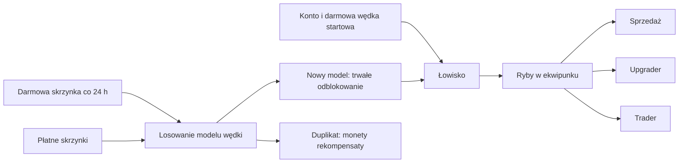

# Mechanika v2 — branch Maks

Zmiany rozwijane są na `Maks`. Merge do `main` jest osobnym krokiem.

## Przebieg gry



Wędka Bambusowa jest przyznawana przy rejestracji i uzupełniana istniejącym
kontom przy migracji lub wejściu do łowiska. Zarzut nią jest darmowy, dzięki
czemu brak monet nie blokuje gry. Pozostałe modele odblokowuje się na stałe
ze skrzynek. Każdy ich zarzut ma osobną opłatę.

Skrzynki nie dają już ryb. Ponowne trafienie posiadanego modelu daje ustaloną
rekompensatę; nie tworzy drugiego egzemplarza i nie zmienia własności.
Wędki nie są wkładem tradera ani upgradera. Stare ryby ze skrzynek pozostają
w ekwipunku i historii.

| Wędka | Koszt zarzutu | Rekompensata za duplikat |
|---|---:|---:|
| Bambusowa | 0 | 2 |
| Spławikowa | 10 | 5 |
| Kij Spinningowy | 25 | 15 |
| Morska | 60 | 40 |
| Głębinowa | 150 | 100 |
| Z Otchłani | 500 | 400 |

## Balans

W aktualnym seedzie średnia wartość ryby z każdej **płatnej** wędki to 90%
opłaty za zarzut. To średnia długookresowa, nie gwarantowany wynik gracza.
Wagi nagród wartych co najmniej 5000 zostały dodatkowo ograniczone:
pojedynczy taki drop ma szansę mniejszą niż 0,01%. Mapa Skarbów za 30000
z Wędki z Otchłani ma szansę około 0,000833% (1 na 120000 zarzutów).
Wędka startowa stanowi celowy wyjątek: daje ryby bez wydawania monet.

Płatne skrzynki kosztują 10, 60 i 750 monet. Średnia rekompensata przy
posiadaniu całej puli jest niższa od ceny skrzynki; nie powstaje zyskowna
pętla otwierania i sprzedawania duplikatów. Darmowa skrzynka ma odrębną
pulę i jest dostępna raz na 86400 sekund od ostatniego udanego odbioru.
Limit dotyczy konta, a nie przeglądarki ani północy. Wszystkie skrzynki
oznaczone jako dzienne współdzielą ten limit.

RTP finansowe uwzględnia tylko losowania z dodatnim kosztem. Odblokowanie
wędki ma wypłatę 0, a duplikat zapisuje rzeczywistą rekompensatę. Raport
osobno pokazuje darmowe wypłaty, liczbę odblokowań i duplikatów.

## Baza i migracja

```bash
php database/migrate.php
php -S localhost:8000
```

Gra działa w katalogu głównym oraz przez `public/`. `dev/playground.html`
pozostaje konsolą API z panelem administratora.

Zwykła migracja zachowuje konta, salda, ekwipunek, ID i historię. Przebudowuje
`historia_losowan`, dopuszczając dokładnie jeden wynik: `wynik_id` ryby albo
`wynik_wedka_id` modelu wędki. Dotychczasowe `wedka_id` nadal oznacza sprzęt
**użyty** przy połowie. Nowe tabele to `uzytkownik_wedki`, `skrzynka_wedki`,
`odbiory_dzienne` i `otwarcia_skrzynek`.

`--fresh` służy wyłącznie do świadomego kasowania danych developerskich.
Do aktualizacji istniejącej gry używamy polecenia bez tej flagi.

Ponowny import aktualizuje konfigurację modeli, skrzynek i wag zapisanych
w CSV. Może więc nadpisać ręczne ustawienia administratora dla seedowanych
pozycji; nie należy wykonywać go przy każdym restarcie serwera. Nie usuwa
przedmiotów graczy. `skrzynka_przedmioty.csv`, klasa `SkrzynkaPrzedmiot`
i oryginalne pliki Draw.io opisują mechanikę v1; nie sterują nowymi nagrodami.
Aktualny przepływ v2 pokazuje diagram powyżej. `Skrzynka::losuj()` oraz
`otworz()` zwracają teraz `Wedka`; stary `ILosujacy(): Przedmiot` pozostaje
wyłącznie dla historycznej klasy wpisu puli.

## API

- `GET api/wedki.php`: katalog, pule ryb i `posiadana` dla zalogowanego konta.
- `POST api/fish.php {wedka_id}`: sprawdza własność na serwerze; brak własności
  daje `403 rod_not_owned` bez pobrania opłaty.
- `GET api/skrzynki.php`: `wedki` z wagami, szansami i rekompensatą,
  `dzienna`, `nastepny_odbior` oraz `czas_serwera` (znaczniki Unix).
- `POST api/open_case.php {skrzynka_id, request_id}`: `request_id` to losowy
  identyfikator 8–100 znaków: litery ASCII, cyfry, `_`, `-` (np. UUID).
  Odpowiedź zawiera `nagroda.typ = "wedka"`, `nagroda.wedka_id`,
  `duplikat`, `rekompensata`, salda i termin kolejnego odbioru.
  Powtórzenie tego samego ID dla tego samego konta i skrzynki odtwarza wynik
  bez kolejnej opłaty. Inna skrzynka z tym samym ID daje `request_id_conflict`.
  Odpowiedź odtworzona zawiera saldo z chwili otwarcia, więc klient odświeża
  także `api/me.php`. Limit dzienny daje `409 daily_case_cooldown`.
- Zapis opłaty, nagrody/rekompensaty, historii, zegara i potwierdzenia jest
  atomowy. Blokada zapisu SQLite jest pobierana przed pierwszym odczytem.
- `POST api/admin/skrzynki.php`: pula `wedki: [{wedka_id, waga}]` zamiast
  `przedmioty`. Flaga `dzienna: true` wymaga ceny 0. Edycja i przełączanie
  aktywności zachowują flagę, jeśli nie została podana.
- Stara opcja `sprzedaj_natychmiast: true` jest odrzucana kodem
  `case_sell_removed`; rekompensata za duplikaty działa automatycznie.

## Interfejs i sprawdzanie

Jeden pasek wyboru trybu działa także na telefonie. Ekran z logo znika po
3 sekundach od otwarcia dokumentu, niezależnie od pobierania API. Karty ryb
w puli łowiska pokazują nazwę i szansę po najechaniu, fokusie lub dotknięciu.
Upgrader ma graficzny wybór wkładu i droższego celu. Pokazuje szansę przed
startem, ukrywa liczby podczas obrotu i prezentuje sukces/porażkę po nim.
Obsługuje ograniczenie animacji przez `prefers-reduced-motion`.

```bash
php tests/run.php
node dev/check-fishing.mjs
```

Zestaw sprawdza również migrację v1, rzeczywisty balans seedów, rollback,
własność, limit 24 h, ponowienia i dwa równoległe procesy SQLite. Testy
wymagają PHP 8.2+ z `pdo_sqlite`, `mbstring`, `ctype` i dostępnym `proc_open`.
CI uruchamia testy backendu oraz kontrolę animacji oprócz lintowania.
